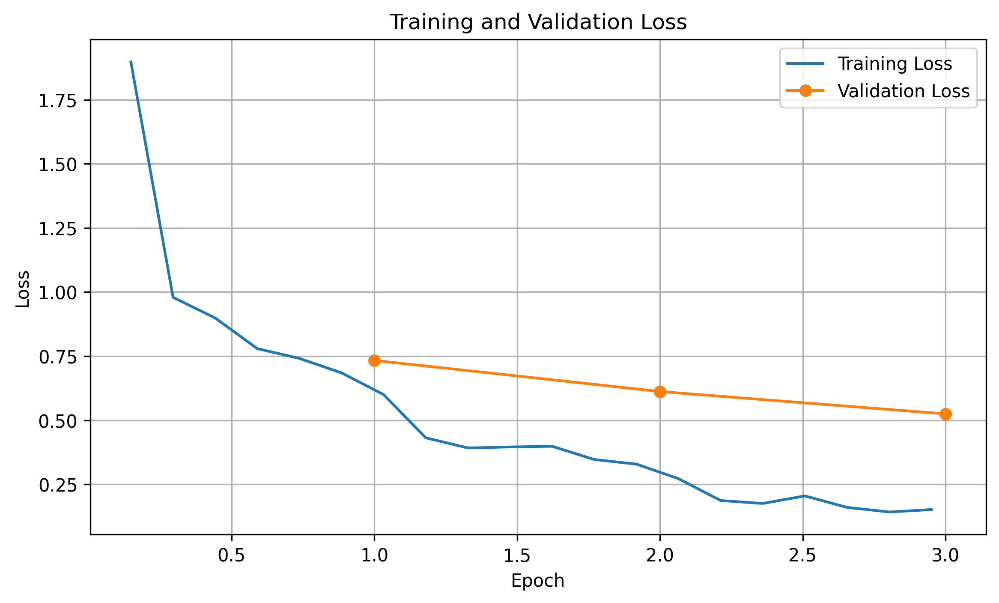
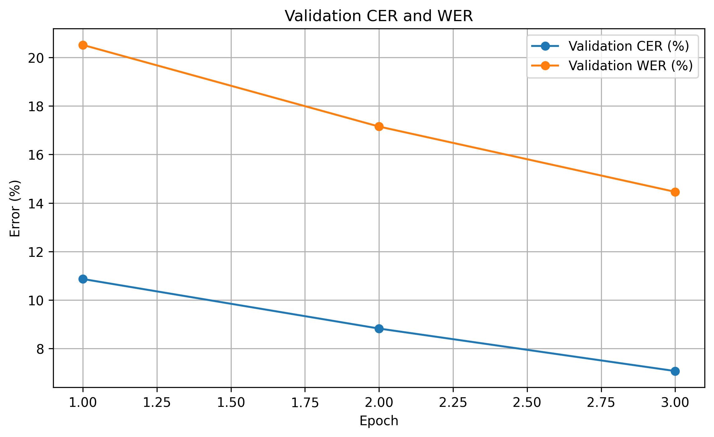
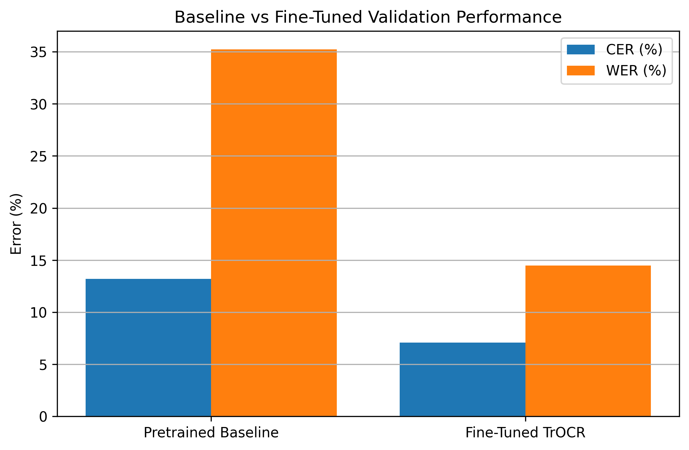

# TrOCR Handwritten Text Recognition

## Project Overview

This project reproduces and fine-tunes the TrOCR (Transformer-based Optical Character Recognition) model for handwritten text recognition using the IAM Handwriting Dataset.

The project uses the pretrained `microsoft/trocr-small-stage1` model and fine-tunes it on handwritten text-line images to improve recognition accuracy.

**Course:** Deep Learning  
**University:** Bahria University  
**Department:** Department of Computer Science

## Team Members

- Abdul Wahab Babar
- M. Asher

**Instructor:** Ma'am Nabeela Bibi

## Research Paper

TrOCR: Transformer-based Optical Character Recognition with Pre-trained Models

Paper: https://arxiv.org/abs/2109.10282

## Dataset

The project uses the IAM Handwriting Dataset.

Dataset source:
https://zenodo.org/records/19003721

### Dataset Split

| Dataset | Number of Samples |
|---|---:|
| Training | 5,419 |
| Validation | 1,539 |
| Testing | 1,480 |
| **Total** | **8,438** |

Only usable records marked with status `ok` were retained from the official writer-independent splits.

## Model Architecture

- Pretrained model: `microsoft/trocr-small-stage1`
- Architecture: Vision Transformer Encoder + Transformer Text Decoder
- Image processing size: 384 × 384
- Maximum target token length: 128

## Training Configuration

| Parameter | Value |
|---|---|
| Epochs | 3 |
| Learning Rate | 5e-5 |
| Batch Size | 2 |
| Gradient Accumulation | 4 |
| Weight Decay | 0.01 |
| Optimizer | AdamW |
| Random Seed | 42 |
| GPU | Google Colab Tesla T4 |

## Experimental Results

### Baseline vs Fine-Tuned Model

| Model | Dataset | CER | WER |
|---|---|---:|---:|
| Pretrained Baseline | Validation | 13.20% | 35.24% |
| Fine-Tuned TrOCR | Validation | 7.07% | 14.46% |
| Fine-Tuned TrOCR | Test | 7.75% | 15.11% |

The fine-tuned model achieved lower Character Error Rate (CER) and Word Error Rate (WER) than the pretrained baseline on the validation set.

### Evaluation Metrics

- **CER (Character Error Rate):** Measures character-level recognition errors.
- **WER (Word Error Rate):** Measures word-level recognition errors.

Lower values indicate better performance.

## Training and Evaluation Visualizations

### Dataset Samples


### Training Loss Curve



### Validation Metrics



### Baseline Comparison



## Repository Structure

```text
TrOCR-Handwritten-Text-Recognition/
│
├── notebooks/
│   └── TrOCR_Assignment_02.ipynb
│
├── src/
│   ├── dataset_preparation.py
│   ├── evaluation.py
│   ├── model.py
│   └── training.py
│
├── plots/
│   ├── dataset_samples.png
│   ├── loss_curve.png
│   ├── validation_metrics.png
│   └── baseline_comparison.png
│
├── results/
│   ├── baseline_results.csv
│   ├── final_metrics.csv
│   ├── training_history.json
│   └── test_predictions.csv
│
├── reports/
│   └── TrOCR_Assignment_02_Report.docx
│
├── requirements.txt
├── .gitignore
└── README.md
```

## Installation

Clone the repository:

```bash
git clone https://github.com/abdulwahab-0/TrOCR-Handwritten-Text-Recognition.git
```

Move into the project directory:

```bash
cd TrOCR-Handwritten-Text-Recognition
```

Install dependencies:

```bash
pip install -r requirements.txt
```

## Running the Project

1. Open `notebooks/TrOCR_Assignment_02.ipynb` in Google Colab.
2. Enable GPU acceleration.
3. Download and prepare the IAM dataset using the provided dataset source.
4. Follow the notebook cells to prepare the data, load the pretrained model, fine-tune it, and evaluate its performance.

The trained model checkpoints and original dataset are not included in this repository because of their size and dataset distribution considerations.

## Limitations

- Recognition errors remain for some proper names and uncommon words.
- Numbers and visually similar characters can be confused.
- The experiment uses a limited three-epoch training schedule.
- Further improvements could be explored through additional training, data augmentation, and hyperparameter tuning.

## Conclusion

This project demonstrates the use of a pretrained Transformer-based OCR model for handwritten text recognition.

Fine-tuning TrOCR on the IAM dataset improved validation CER from 13.20% to 7.07% and validation WER from 35.24% to 14.46%.

The final held-out test results were 7.75% CER and 15.11% WER.

## References

1. Li et al. (2021). TrOCR: Transformer-based Optical Character Recognition with Pre-trained Models. https://arxiv.org/abs/2109.10282
2. IAM Handwriting Database: https://www.iam.unibe.ch/fki/databases/iam-handwriting-database
3. Hugging Face TrOCR Model: https://huggingface.co/microsoft/trocr-small-stage1
4. IAM Dataset Zenodo Record: https://zenodo.org/records/19003721
